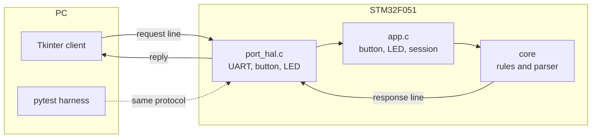
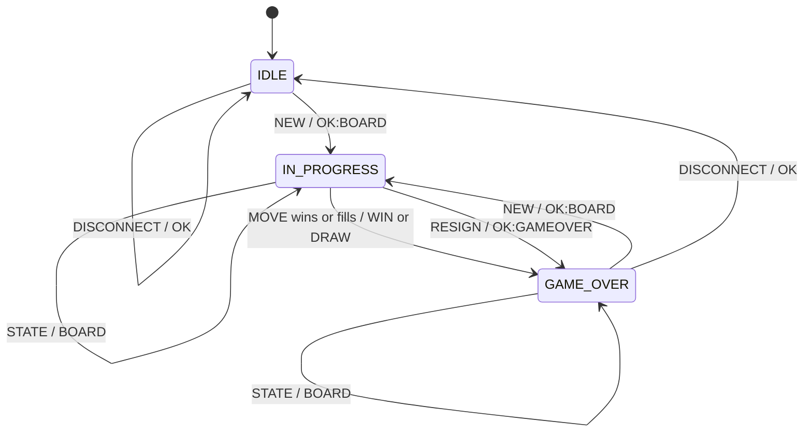
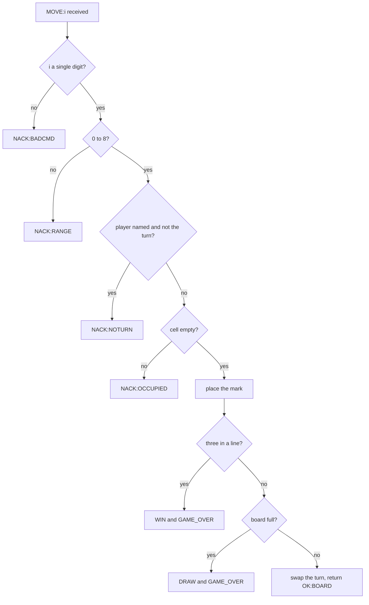
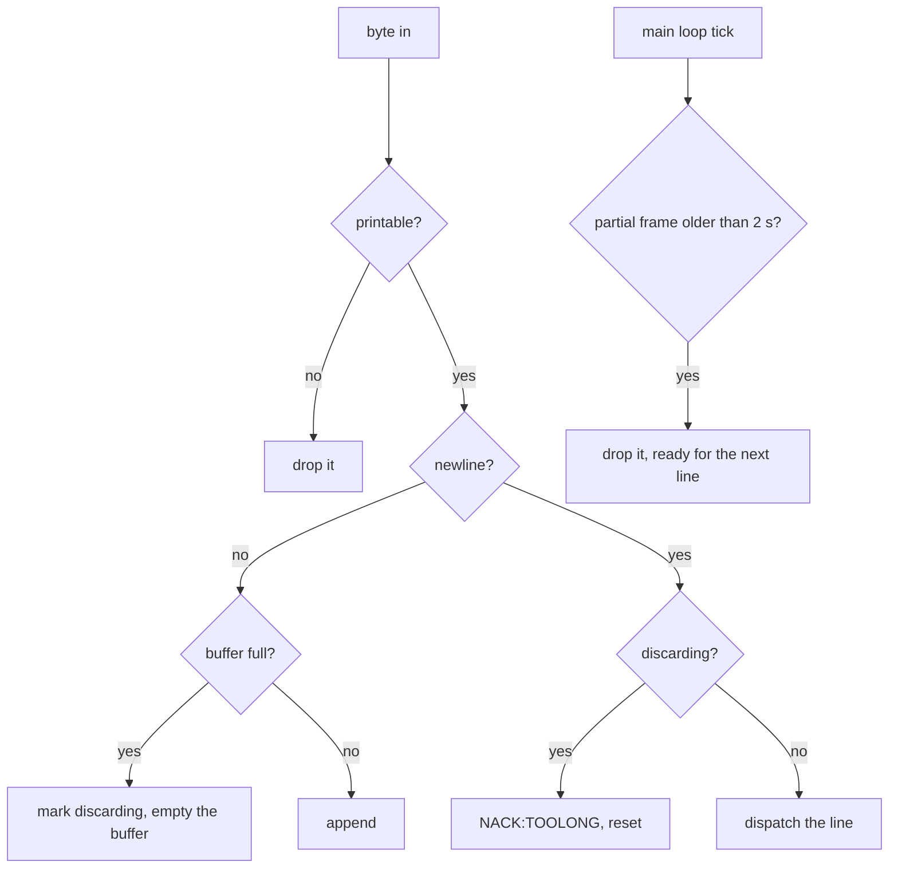
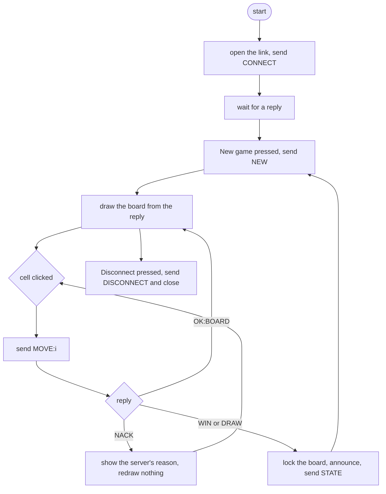
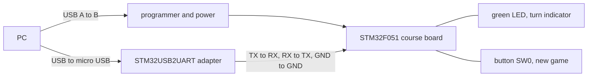

# Design

## Where the rules live

The board is the referee. The client sends requests and draws whatever comes
back; it holds no copy of the rules. Everything that decides anything is in
`server/core/`, which builds for the STM32 and for the host without a change,
so the same code that runs in the lab is what the tests run on a laptop.

## Server state machine

Anything a state does not accept is answered `NACK:NOGAME` and changes nothing.

## Move validation

Each rejection returns before the board is touched, which is what makes the
client-untrusted claim testable: the test asserts the board after the rejection
is the board before it.

## Frame handling

## GUI flow

The client never decides that a click is illegal. It sends the move and shows
what the server says about it.

## Link

Two USB connections, and they do different jobs: one powers and flashes the
board, the other is the serial port the client opens. 115200 8N1, no flow
control. The adapter's TX goes to the board's UART RX and its RX to the board's
TX, grounds common.
